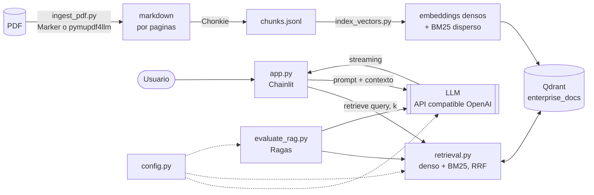

# Módulo 5 — Implementación (Ejercicios 1 y 2)

RAG sobre PDF con **Marker + Chonkie + Qdrant + Chainlit**, y evaluación del
pipeline con **Ragas**. Todo corre en local: el LLM y los embeddings salen de
**Ollama**, así que no hace falta ninguna API key ni hay coste por token.

## Arquitectura



Las flechas punteadas marcan lo que hace flexible el diseño: `config.py` es el
único sitio que sabe qué proveedor de LLM hay detrás, y `retrieval.py` el único
que sabe cómo se busca.


| Fichero | Responsabilidad |
|---|---|
| `config.py` | Único punto que conoce el proveedor de LLM/embeddings y las rutas |
| `ingest_pdf.py` | PDF → markdown (cacheado) → `chunks.jsonl` |
| `index_vectors.py` | `chunks.jsonl` → colección `enterprise_docs` de Qdrant |
| `retrieval.py` | `retrieve(pregunta, k)`, búsqueda densa o híbrida, y montaje del prompt |
| `app.py` | Chat Chainlit con streaming y citas |
| `evaluate_rag.py` | Ejercicio 2: métricas de Ragas |

## Requisitos previos

1. **Ollama** con los dos modelos descargados:
   ```powershell
   ollama pull qwen2.5:7b-instruct
   ollama pull nomic-embed-text
   ```
2. **Docker Desktop** arrancado (para Qdrant).
3. Python 3.11.

**Con esos tres requisitos basta para reproducir todo.** El markdown ya
extraído se versiona en `data/processed/*.md`, así que la ingesta corre sin
Marker, sin GPU y sin descargar modelos. Los requisitos del extractor que hay
debajo solo aplican si quieres rehacer la extracción desde el PDF (`--force`).

<details>
<summary>Requisitos del backend Marker (solo para re-extraer)</summary>

`marker-pdf==2.0.0` arrastra `surya-ocr`, que **no corre los modelos en el
proceso de Python**: levanta un contenedor Docker `vllm/vllm-openai`
(`surya-vllm-<puerto>`) y le habla por HTTP. Por tanto necesita:

- **Docker Desktop** arrancado y la imagen `vllm/vllm-openai` (varios GB, se
  descarga sola la primera vez).
- **GPU NVIDIA** con VRAM libre para ese servidor. `pip` instala por defecto la
  build de PyTorch para CPU; hay que sustituirla:

  ```powershell
  .\.venv\Scripts\python.exe -m pip uninstall -y torch torchvision
  .\.venv\Scripts\python.exe -m pip install --index-url https://download.pytorch.org/whl/cu130 torch==2.13.0 torchvision
  .\.venv\Scripts\python.exe -c "import torch; print(torch.cuda.is_available())"
  ```

  Sustituye `cu130` por la versión de CUDA que soporte tu driver (`nvidia-smi`).

- Que **no haya un contenedor `surya-vllm-*` viejo** ocupando la GPU. Si lo hay,
  el arranque del nuevo agota su espera de 600 s y falla con
  `SpawnError: vllm server failed to become healthy`. Se limpia con
  `docker rm -f $(docker ps -aq --filter name=surya-vllm)`.

Sin GPU, o si no quieres pelearte con esto, `--backend pymupdf` extrae en
segundos y sin modelos, a cambio de partir las celdas multilínea de las tablas
(ver [informe.md](informe.md), sección 2).

</details>

## Puesta en marcha

```powershell
cd module-5
python -m venv .venv
.\.venv\Scripts\python.exe -m pip install -r requirements.txt
Copy-Item .env.example .env

docker compose up -d                       # Qdrant en http://localhost:6333/dashboard

# Ingesta: PDF -> markdown -> chunks
# Reutiliza data\processed\*.md (versionado), asi que no necesita Marker ni GPU.
.\.venv\Scripts\python.exe ingest_pdf.py data\raw\lakeflow-connect-sqlserver.pdf --page-offset 43

# Indexado en Qdrant
.\.venv\Scripts\python.exe index_vectors.py data\processed\lakeflow-connect-sqlserver.chunks.jsonl --recreate

# Chat
.\.venv\Scripts\python.exe -m chainlit run app.py -w
```

### Corpus

`data/raw/lakeflow-connect-sqlserver.pdf` son las páginas 44–58 del
*Big Book of Data Engineering* de Databricks, recortadas para que la extracción
tarde minutos y no horas. Contiene dos tablas (compatibilidad de nubes y
permisos de Unity Catalog) que son las que se usan en la demo. El recorte se
hizo así:

```python
import pymupdf
src = pymupdf.open("big-book-data-engineering.pdf")
out = pymupdf.open()
out.insert_pdf(src, from_page=43, to_page=57)   # páginas 44-58, 1-indexadas
out.save("data/raw/lakeflow-connect-sqlserver.pdf")
```

Por eso `--page-offset 43`: así el `page_number` que se guarda en Qdrant es el
número de página del libro original y las citas del chat son verificables.

## Opciones de la ingesta

```
--backend marker|pymupdf   solo se usa si no hay .md cacheado o con --force.
                           marker (por defecto) necesita GPU y un contenedor
                           Docker de vLLM (ver "Requisitos previos"); pymupdf
                           es instantaneo, no requiere modelos y sirve para
                           iterar
--chunker recursive|token  recursive corta por la estructura del markdown y no
                           parte tablas; token da el solape del 10% del enunciado
--chunk-size 500           tokens por chunk
--force                    reextrae aunque ya exista el .md cacheado
```

Diferencia medida entre los dos backends sobre este PDF: Marker mantiene enteras
las filas de las tablas, mientras que pymupdf parte cada celda multilínea en una
fila suelta. Eso se nota en la evaluación, donde `context_precision` sube de
0.800 a 1.000 solo por cambiar de extractor (ver [informe.md](informe.md)).

A cambio, Marker alinea las columnas rellenando con espacios, y ese relleno
triplica los tokens de una tabla hasta pasarse del `chunk_size`. Por eso el
troceado hace dos cosas antes de cortar:

- `compact_tables()` quita el relleno, con lo que la tabla vuelve a caber entera
  en un chunk. El `.md` conserva la versión alineada, que es la legible.
- `repair_table_header()` devuelve la fila de cabecera a cualquier chunk que
  empiece en mitad de una tabla, por si alguna sigue sin caber.

Sin esto, la mitad inferior de una tabla partida son filas sin nombre de columna
y el modelo confunde unas columnas con otras.

El markdown intermedio queda en `data/processed/*.md` con marcas
`<!-- page: N -->`. Al reejecutar sin `--force` se reutiliza, así que el paso
caro no se repite.

**Ese `.md` se versiona en el repositorio a propósito.** Es el único artefacto
caro de la ingesta (necesita Marker, GPU y Docker), y sin él un clon limpio no
podría reproducir los 21 chunks sobre los que está construido el informe. Los
`.chunks.jsonl` sí se ignoran: los regenera el comando de arriba en un segundo,
de forma determinista. Para rehacer la extracción desde el PDF:

```powershell
.\.venv\Scripts\python.exe ingest_pdf.py data\raw\lakeflow-connect-sqlserver.pdf --page-offset 43 --force                     # Marker (requisitos arriba)
.\.venv\Scripts\python.exe ingest_pdf.py data\raw\lakeflow-connect-sqlserver.pdf --page-offset 43 --force --backend pymupdf   # sin GPU ni Docker
```

## Ejercicio 2 — Evaluación

```powershell
.\.venv\Scripts\python.exe evaluate_rag.py                 # dataset de ejemplo
.\.venv\Scripts\python.exe evaluate_rag.py --dataset rag   # el RAG real
```

El modo `rag` lanza las preguntas de `data/eval_questions.json` contra el
pipeline del ejercicio 1, así que los contextos y las respuestas son los de
verdad. Los resultados se guardan en `resultados_ragas_*.csv`, y el análisis
está en [informe.md](informe.md).

El nombre del CSV incluye el modo de recuperación, lo que permite comparar
configuraciones sin pisar resultados anteriores:

```powershell
$env:RETRIEVAL_MODE="dense";  .\.venv\Scripts\python.exe evaluate_rag.py --dataset rag
$env:RETRIEVAL_MODE="hybrid"; .\.venv\Scripts\python.exe evaluate_rag.py --dataset rag
```

## Tarea opcional implementada: búsqueda híbrida

Cada chunk se indexa con **dos** vectores: el denso de `nomic-embed-text` y uno
disperso BM25 de `fastembed`. En la consulta, cada uno busca por su cuenta y
Qdrant fusiona los dos rankings con **Reciprocal Rank Fusion**.

RRF puntúa por *posición*, no por score, y eso es justo lo que hace falta: una
distancia coseno y un peso BM25 están en escalas distintas y no se pueden sumar,
pero sus rankings sí se pueden combinar.

En la colección, el vector disperso se declara con `modifier=Modifier.IDF` para
que Qdrant calcule la parte IDF de BM25 con las estadísticas de todo el corpus:
`fastembed` no puede saberlas vectorizando un chunk aislado.

Se controla con una variable de entorno, sin tocar código:

```
RETRIEVAL_MODE=hybrid   # o 'dense' para volver a búsqueda semántica pura
PREFETCH_LIMIT=20       # candidatos que aporta cada rama antes de fusionar
```

Resultado medido sobre las 5 preguntas de evaluación, misma extracción y mismo
`TOP_K = 4`:

| Métrica | dense | hybrid |
|---|---|---|
| faithfulness | 0.667 | **0.933** |
| answer_relevancy | 0.727 | **0.931** |
| context_precision | 1.000 | 1.000 |
| context_recall | 0.800 | **1.000** |

El detalle de por qué sube está en [informe.md](informe.md). `app.py` y
`evaluate_rag.py` no se modificaron en absoluto.

## Desviaciones respecto al enunciado

### Chunking: estructura en vez de solape

El enunciado pide chunks de ~500 tokens **con un 10% de solape**, y a la vez que
"los contextos de encabezado y las tablas no se corten bruscamente". Sobre este
PDF las dos cosas tiran en direcciones opuestas: el solape se implementa
cortando cada N tokens, que es justo lo que parte una tabla por la mitad.

Por defecto se usa `RecursiveChunker` con la receta de markdown, que corta en
fronteras de encabezado, párrafo y fila. No lleva solape, y a cambio ninguna
tabla queda partida. Se compensa por otra vía: cada chunk se vectoriza precedido
de su encabezado de sección (`embedding_text()` en `index_vectors.py`), que es
el contexto que el solape pretende conservar.

El chunker con el solape del 10% literal está implementado y a un flag de
distancia:

```powershell
.\.venv\Scripts\python.exe ingest_pdf.py data\raw\mi.pdf --chunker token
```

### API de Ragas

El enunciado usa una API de Ragas anterior a la 0.4. Verificado contra `ragas==0.4.3`:

- La métrica no se llama `answer_relevance` sino `answer_relevancy`
  (clase `ResponseRelevancy`).
- El dataset se construye con `EvaluationDataset` y
  `SingleTurnSample(user_input, retrieved_contexts, response, reference)`,
  no con `Dataset.from_dict` y las claves `question / contexts / answer / ground_truth`.
- Ragas 0.4.3 no acota la versión de langchain y con la rama 1.x falla al importar
  (`ModuleNotFoundError: langchain_community.chat_models.vertexai`). De ahí los cuatro
  pines de `requirements.txt`.

(Los enlaces a los repos de Marker y Chonkie del enunciado apuntan a repositorios que
no existen; los correctos son `datalab-to/marker` y `chonkie-inc/chonkie`.)

## Cómo entran las tareas opcionales

| Tarea opcional | Estado | Qué toca |
|---|---|---|
| **Búsqueda híbrida** (denso + BM25) | **implementada** | El esquema de la colección y el cuerpo de `retrieve()`. `app.py` y `evaluate_rag.py` no se tocaron |
| **LiteLLM** como gateway | pendiente | `OPENAI_BASE_URL` en el `.env`. Cero cambios en `.py` |
| **Langfuse** | pendiente | Envolver el cliente en `config.get_client()` / `get_async_client()` |
| **Orquestación** (Airflow/Prefect) | pendiente | Invocar `ingest_pdf.py` e `index_vectors.py` como tareas: ya son idempotentes y se comunican por ficheros |

La híbrida era la predicción de diseño más fuerte del README original ("el
cuerpo de `retrieve()`, y `app.py` no se entera"). Se cumplió: el diff toca
`config.py`, `index_vectors.py` y `retrieval.py`, y ni una línea de `app.py`.

## Dónde está cada entregable

### Ejercicio 1

| Entregable del enunciado | Dónde |
|---|---|
| 1. Diagrama de arquitectura | El mermaid al principio de este README |
| 2. `docker-compose.yml` | [docker-compose.yml](docker-compose.yml) |
| 2. Scripts de parseo, chunking e indexado | [ingest_pdf.py](ingest_pdf.py), [index_vectors.py](index_vectors.py) |
| 2. Frontend Chainlit | [app.py](app.py) |
| 2. `requirements.txt` con versiones pineadas | [requirements.txt](requirements.txt) |
| 3. Prueba de la UI en funcionamiento | [capturas/](capturas/) |
| Opcional: búsqueda híbrida | `retrieval.py` + sección anterior |

### Ejercicio 2

| Entregable del enunciado | Dónde |
|---|---|
| 1. Script `evaluate_rag.py` | [evaluate_rag.py](evaluate_rag.py) |
| 2. Tabla de resultados de las 4 métricas | [informe.md](informe.md) §1, y `resultados_ragas_sample.csv` |
| 3. Análisis de rendimiento | [informe.md](informe.md) §4 (qué hacer si baja cada métrica) |

Extra sobre lo pedido: la evaluación se corre también contra el RAG real del
ejercicio 1, no solo contra el dataset de ejemplo
(`resultados_ragas_rag_dense.csv` y `resultados_ragas_rag_hybrid.csv`).
