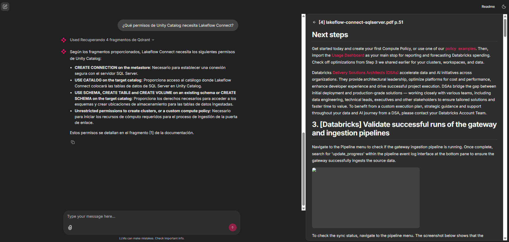
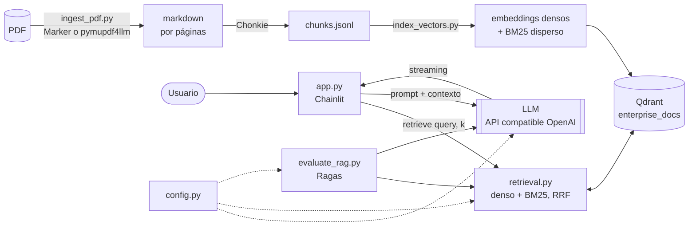

# Enterprise RAG con Qdrant híbrido y evaluación Ragas

[](https://github.com/Oppen-OC/enterprise-rag-ragas/actions/workflows/ci.yml)
[](LICENSE)

Un chat que responde **solo** con lo que dice un PDF técnico, cita las páginas
que ha usado y se niega a inventar lo que no está. Funciona sobre un capítulo
del *Big Book of Data Engineering* de Databricks, con tablas incluidas.

Lo interesante no es el chat, es la parte de medir: el pipeline se evalúa con
**Ragas**, se diagnostica que el cuello de botella era el retriever y no el
generador, y se arregla con **búsqueda híbrida (denso + BM25, fusionados con
RRF)**. El análisis completo está en [docs/informe.md](docs/informe.md).

Todo corre en local: LLM y embeddings salen de **Ollama**, sin API keys ni coste
por token.



## Resultados: denso vs híbrido

Mismas 5 preguntas con respuesta conocida ([data/eval_questions.json](data/eval_questions.json)),
misma extracción, 21 chunks, `TOP_K = 4`. Solo cambia `RETRIEVAL_MODE`. Medias
calculadas desde [resultados_ragas_rag_dense.csv](resultados_ragas_rag_dense.csv) y
[resultados_ragas_rag_hybrid.csv](resultados_ragas_rag_hybrid.csv):

| Métrica | denso | híbrido |
|---|---|---|
| faithfulness | 0.667 | **0.933** |
| answer_relevancy | 0.727 | **0.931** |
| context_precision | 1.000 | 1.000 |
| context_recall | 0.800 | **1.000** |

El salto viene de una sola pregunta: el chunk con la respuesta ("SQL Server 2012
o posterior para change tracking") salía en el puesto 6 con búsqueda densa, fuera
del top-4, y con BM25 pasa al puesto 2 porque "change tracking" aparece literal en
él. El generador nunca fue el problema.

**Cómo leer estas cifras:** son 5 preguntas y juez y generador son el mismo
modelo de 7B. El juez no es determinista ni con `temperature=0` (dos corridas de
la misma configuración dieron `faithfulness` 0.900 y 0.933). Diferencias de ±0.03
no significan nada; el salto de +0.27 sí. Más límites en
[docs/informe.md](docs/informe.md), sección 5.

## Arquitectura



## Stack

| Capa | Herramienta |
|---|---|
| Extracción PDF → markdown | Marker (GPU) o pymupdf4llm (ligero, sin modelos) |
| Chunking | Chonkie (`RecursiveChunker` por estructura, o `TokenChunker` con solape) |
| Vector store | Qdrant, un vector denso (`nomic-embed-text`) y uno disperso (BM25 de `fastembed`) por chunk |
| LLM y embeddings | Ollama (`qwen2.5:7b-instruct`, `nomic-embed-text`) tras una API compatible OpenAI |
| Chat | Chainlit, con streaming y fuentes citables en el panel lateral |
| Evaluación | Ragas 0.4.3 |

## Arranque rápido

Requisitos: **Ollama**, **Docker Desktop** y **Python 3.11**.

```powershell
ollama pull qwen2.5:7b-instruct
ollama pull nomic-embed-text

python -m venv .venv
.\.venv\Scripts\python.exe -m pip install -r requirements.txt
Copy-Item .env.example .env

docker compose up -d        # Qdrant en http://localhost:6333/dashboard
```

El corpus no está en el repo (ver [Corpus](#corpus)). Con el PDF ya recortado en
`data\raw\lakeflow-connect-sqlserver.pdf`:

```powershell
# PDF -> chunks. --backend pymupdf no necesita GPU ni Docker (ver "Qué backend usar")
.\.venv\Scripts\python.exe ingest_pdf.py data\raw\lakeflow-connect-sqlserver.pdf --page-offset 43 --backend pymupdf

# chunks -> Qdrant
.\.venv\Scripts\python.exe index_vectors.py data\processed\lakeflow-connect-sqlserver.chunks.jsonl --recreate

# chat
.\.venv\Scripts\python.exe -m chainlit run app.py -w
```

Evaluación (el nombre del CSV incluye el modo, así que no se pisan):

```powershell
$env:RETRIEVAL_MODE="dense";  .\.venv\Scripts\python.exe evaluate_rag.py --dataset rag
$env:RETRIEVAL_MODE="hybrid"; .\.venv\Scripts\python.exe evaluate_rag.py --dataset rag
```

Tests (no necesitan Docker ni Ollama):

```powershell
.\.venv\Scripts\python.exe -m pip install pytest ruff
.\.venv\Scripts\python.exe -m pytest
```

## Corpus

El PDF no se versiona: es contenido de Databricks. Son las páginas 44–58 de su
*Big Book of Data Engineering* (capítulo *Lakeflow Connect: SQL Server
Connector*), que se descarga de
[databricks.com](https://www.databricks.com/resources/ebook/big-book-of-data-engineering).
Se recorta para que la extracción con Marker tarde minutos y no horas:

```python
import pymupdf
src = pymupdf.open("big-book-data-engineering.pdf")
out = pymupdf.open()
out.insert_pdf(src, from_page=43, to_page=57)   # páginas 44-58, 1-indexadas
out.save("data/raw/lakeflow-connect-sqlserver.pdf")
```

`--page-offset 43` hace que el `page_number` guardado en Qdrant sea la página del
libro original, así que las citas del chat se pueden verificar contra el PDF.

`data/processed/` (markdown extraído y chunks) tampoco se versiona: se regenera
con `ingest_pdf.py`.

**Qué backend usar.** Las cifras de arriba salen de la extracción con **Marker**
(21 chunks), que necesita GPU NVIDIA y Docker ([docs/marker.md](docs/marker.md)).
`--backend pymupdf` extrae en segundos sin modelos y da 19 chunks, con las filas
de las tablas partidas; sirve para probar el sistema, pero no reproduce
exactamente esas cifras.

## Estructura

```
config.py               único punto que conoce el proveedor de LLM/embeddings y las rutas
ingest_pdf.py           PDF -> markdown (cacheado) -> chunks.jsonl
index_vectors.py        chunks.jsonl -> colección enterprise_docs de Qdrant
retrieval.py            retrieve(pregunta, k), búsqueda densa o híbrida, y montaje del prompt
app.py                  chat Chainlit con streaming y citas
evaluate_rag.py         métricas de Ragas, sobre un dataset de ejemplo o el RAG real
tests/                  retrieval.py contra un Qdrant en memoria
data/eval_questions.json  5 preguntas con respuesta de referencia
resultados_ragas_*.csv  salida de evaluate_rag.py
docs/                   informe de evaluación, memoria, capturas y enunciado del curso
```

## Decisiones de diseño

**`config.py` es el único que conoce al proveedor.** Ningún otro fichero crea
clientes ni conoce URLs. Cambiar de modelo es tocar `LLM_MODEL` en el `.env`;
apuntar a OpenAI o a un gateway LiteLLM es tocar `OPENAI_BASE_URL`; instrumentar
con Langfuse sería envolver `get_client()`. Cero cambios en el resto.

**`retrieval.py` es el único que sabe cómo se busca.** `app.py` y
`evaluate_rag.py` solo conocen `retrieve(pregunta, k)`. Por eso añadir la
búsqueda híbrida tocó `config.py`, `index_vectors.py` y `retrieval.py`, y ni una
línea de `app.py`.

**RRF en vez de sumar scores.** Una distancia coseno y un peso BM25 están en
escalas distintas y no se pueden sumar; sus *rankings* sí se pueden combinar.
La fusión la hace Qdrant, y el vector disperso se declara con `Modifier.IDF`
para que calcule la parte IDF de BM25 con las estadísticas de todo el corpus.

**Chunking por estructura, no por solape.** El enunciado pide ~500 tokens con 10%
de solape *y* que las tablas no se partan, y en este PDF las dos cosas chocan: el
solape corta cada N tokens, que es justo lo que parte una tabla. Se usa
`RecursiveChunker` con la receta de markdown (corta por encabezado, párrafo y
fila) y cada chunk se vectoriza precedido de su encabezado de sección, que es el
contexto que el solape pretendía conservar. El chunker con solape literal está a
un flag: `--chunker token`.

**Las tablas de Marker se compactan antes de trocear.** Marker alinea columnas
con espacios, lo que triplica los tokens de una tabla y la hacía pasar de
`chunk_size`; al partirla, la mitad inferior quedaba sin fila de cabecera y el
modelo confundía columnas. `compact_tables()` quita el relleno y
`repair_table_header()` devuelve la cabecera a cualquier chunk que empiece a
mitad de tabla. Ninguna de las cuatro métricas de Ragas detectó ese fallo; se
encontró leyendo los chunks (detalle en [docs/informe.md](docs/informe.md), sección 2).

## Límites conocidos

- **Evaluación pequeña.** 5 preguntas y un único PDF de 15 páginas. Sirve para
  diagnosticar, no para comparar configuraciones finas.
- **El juez de 7B a veces falla.** En una repetición de la evaluación híbrida, 6 de
  las 20 puntuaciones salieron `NaN` (Ragas no logró parsear la salida del juez), y
  la densa dio `faithfulness` 0.800 en vez de 0.667. La conclusión cualitativa se
  mantuvo (el recall de la pregunta 1 es 0 en denso y 1 en híbrido), las medias
  exactas no.
- **Juez y generador son el mismo modelo** (`qwen2.5:7b-instruct`), con el sesgo
  a favor de sus propias respuestas que eso implica.
- **No hay reranker, ni LiteLLM, ni Langfuse, ni orquestación.** El diseño deja
  el sitio para cada uno, pero no están implementados.
- **El generador no siempre respeta el idioma de la pregunta**, y ninguna de las
  cuatro métricas lo capta.
- **Marker exige GPU NVIDIA y Docker** (levanta un contenedor `vllm`). Sin ellos,
  `--backend pymupdf` extrae en segundos a cambio de partir las celdas
  multilínea de las tablas (`context_precision` 0.800 en vez de 1.000).
  Requisitos y solución de problemas de Marker: [docs/marker.md](docs/marker.md).

## Contexto

Solución al Módulo 5 (RAG empresarial y evaluación con Ragas) del curso
*Enterprise Data & AI Architectures* (UPV). El enunciado original está en
[docs/exercise-statement.md](docs/exercise-statement.md) y la memoria entregada
en [docs/memoria-modulo-5.pdf](docs/memoria-modulo-5.pdf).

## Licencia

Código bajo [licencia MIT](LICENSE). El corpus es de Databricks y no se incluye.
